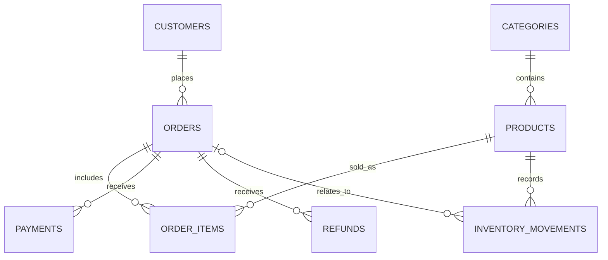

# RetailPulse

### Retail analytics and transactional stock reservations in MySQL

[](https://github.com/k-m-rahaman/SQL-Journey/actions/workflows/retailpulse.yml)


**A complete SQL portfolio project that connects database design, business analysis, and transaction safety.** Build a retail database, investigate revenue and customer behavior, reserve stock safely, and check the results with executable SQL assertions.

The business question: **Which customers, products, and channels drive sustainable sales—and where do refunds, payment issues, or stock shortages need attention?**

## What you build

| Component | What it demonstrates |
| --- | --- |
| Eight related InnoDB tables | Keys, constraints, normalization, and historical price snapshots |
| Deterministic 2025 sample data | 600 customers, 24 products, and 3,600 orders; no external dataset required |
| Reusable financial views | Aggregate each child table before joining to prevent inflated totals |
| Business reports | Revenue trends, product rankings, RFM, retention, repeat orders, baskets, and inventory |
| Stock reservation procedure | Row locking, input validation, commit, rollback, and error handling |
| SQL assertions and CI | Fail the build when a data rule or transactional expectation breaks |
| Query plans | Examine index access and actual execution using `EXPLAIN ANALYZE` |

All people and transactions are fictional. Amounts represent **INR**. The reporting window is **2025-01-01 inclusive to 2026-01-01 exclusive**, with a fixed analysis date of **2026-01-01** for reproducible results.

## Run in a few minutes

Install Docker with Linux containers and Docker Compose v2.20 or newer. No separate MySQL installation or language packages are needed for this route.

```bash
git clone https://github.com/k-m-rahaman/SQL-Journey.git
cd SQL-Journey/Projects/RetailPulse
```

**Windows PowerShell:**

```powershell
.\scripts\run.ps1
```

**macOS, Linux, or Git Bash:**

```bash
bash scripts/run.sh
```

The runner starts MySQL 8.4, waits for it to become healthy, builds the schema, loads the fixture, creates views and the procedure, runs assertions, prints analytical reports, and examines query plans. It stops at the first failure.

Compose publishes no host port and retains the database in a named volume. Its default password, `retailpulse_demo`, is for this local exercise. Set `RETAILPULSE_PASSWORD` before the first run to choose another password; changing it later does not update an existing database volume.

### Run an existing database again

The full build expects empty project tables. A second full run fails instead of overwriting your data. Use the narrower modes after a successful build:

```powershell
.\scripts\run.ps1 -Mode test
.\scripts\run.ps1 -Mode analytics
.\scripts\run.ps1 -Mode performance
```

```bash
bash scripts/run.sh test
bash scripts/run.sh analytics
bash scripts/run.sh performance
```

Stop the database while keeping its data:

```bash
docker compose down
```

To deliberately rebuild the fixture, **the following command permanently deletes this Compose project's database volume**. Run it only when you want to discard your RetailPulse experiments, then run the full build again:

```bash
docker compose down --volumes
```

### Use an existing MySQL installation

MySQL **8.0.18 or newer** is required. Open the MySQL command-line client from this project directory using an account permitted to create the `retailpulse` database, tables, views, stored procedures, and test triggers:

```bash
mysql --user=root --password
```

Run these commands inside the MySQL client, in this order. Stop if any statement fails:

```sql
SOURCE sql/01_schema.sql;
SOURCE sql/02_seed.sql;
SOURCE sql/03_views.sql;
SOURCE sql/05_procedures.sql;
SOURCE sql/06_tests.sql;
SOURCE sql/04_analytics.sql;
SOURCE sql/07_performance.sql;
```

The schema does not drop an existing database. Use a fresh local instance if `retailpulse` already contains unrelated tables. These scripts use MySQL syntax, including `DELIMITER`; they are not SQLite or PostgreSQL scripts.

The test mode expects the original fixture. It creates and removes disposable records and a session-controlled fault-injection trigger to verify rollback after a late failure. Run it before adding your own data; a failed test can leave test objects that require a fresh fixture.

## Verified sample results

All seven SQL scripts and a second test run passed on **MySQL 8.0.46**. The baseline contains **3,240 qualifying orders**, **580 purchasing customers**, **INR 12,933,243.54 net revenue**, and **INR 6,515,703.54 gross profit**. These are synthetic exercise results.

See [analysis results and control totals](docs/analysis_results.md) for expected outputs, channel comparisons, and stock-review examples. GitHub Actions separately checks the project on MySQL 8.4.

## Database design



An order has many lines, payment attempts, and refunds. Joining all three child tables directly multiplies rows. The financial view first reduces each child table to one row per order, then joins the aggregates. Customer and product details remain separate from transactional facts.

Order items store the unit price and cost at sale time, so changing a product's current catalog price does not rewrite historical results. See the [data dictionary](docs/data_dictionary.md) for table grains and metric definitions.

## Questions the SQL answers

- How much revenue and gross profit did qualifying orders generate?
- How did revenue change month to month, including months without orders?
- Which products lead each category before unallocated order refunds?
- Which customers rank highly for recency, frequency, and monetary value?
- How many customers return after their first purchase, by cohort month?
- How does cumulative revenue develop through the year?
- Which products are bought together?
- How much order revenue comes from first purchases versus repeat purchases?
- Which previously active customers might need reactivation?
- Do captured payments reconcile with order values?
- Which products need stock attention based on recent demand?
- How do refunds and sales vary by channel?
- Which registered customers have never made a qualifying purchase?

Open [04_analytics.sql](sql/04_analytics.sql) to read the business question, query, and interpretation notes together. The report SQL uses a fixed date window instead of the computer's current date.

## How to interpret the numbers

| Metric | Definition |
| --- | --- |
| Qualifying order | Status is `paid`, `shipped`, or `completed`; `pending` and `cancelled` are excluded from sales reports |
| Gross sales | Sum of `quantity × unit_price` at line level |
| Discounts | Sum of `discount_amount`, a total discount for each line, not a per-unit discount |
| Net sales | Gross sales minus discounts, before refunds |
| Net revenue | Net sales minus order-level refunds for qualifying orders; zero for other statuses |
| Cost of goods | Sum of `quantity × unit_cost` from the historical line snapshots |
| Gross profit | Net revenue minus cost of goods for qualifying orders; zero for other statuses; refunds do not restore cost of goods |
| Captured amount | Sum of successful captured payment rows; failed attempts contribute zero |

Refunds are attributed to the original order date in revenue reports. This is an **order-value analysis**, not a cash-flow statement by refund payment date. Product reports use sales before refunds because order-level refunds cannot be allocated reliably to individual products. Cohort reports should be read only for observable months; a future month is not a zero-retention result.

The fixture intentionally includes a month without orders, non-buyers, pending and cancelled orders, failed payment attempts, and orders with multiple refund rows. Opening inventory represents an independent current stock snapshot; historical fixture orders are not replayed through the stock ledger.

`v_order_financials` includes every order for reconciliation. `v_customer_metrics` returns all registered customers with all-time qualifying purchase totals. `v_monthly_sales` returns observed selling months; the monthly report joins a calendar spine to include empty months.

## Transactional stock reservation

`sp_place_order(customer_id, product_id, quantity, channel, OUT order_id)` validates a single-product request, locks the product row, reserves available stock, creates a **pending** order and line, and records the inventory movement in one transaction. An error rolls the transaction back.

Call the procedure outside an active transaction because it owns its transaction boundary. It does not capture a payment. A production system would also need payment authorization, idempotency, reservation expiry, cancellation release, and multi-product checkout.

To try a reservation after the baseline checks, run this in MySQL. It deliberately adds an order and reserves two units:

```sql
USE retailpulse;
CALL sp_place_order(1, 1, 2, 'web', @new_order_id);
SELECT @new_order_id;
SELECT * FROM orders WHERE order_id = @new_order_id;
```

## Project map

```text
Projects/RetailPulse/
├── README.md
├── compose.yaml
├── docs/
│   └── data_dictionary.md
├── scripts/
│   ├── run.ps1
│   └── run.sh
└── sql/
    ├── 01_schema.sql        Tables, constraints, and indexes
    ├── 02_seed.sql          Deterministic synthetic dataset
    ├── 03_views.sql         Reusable financial and customer views
    ├── 04_analytics.sql     Business questions and analysis
    ├── 05_procedures.sql    Transactional stock reservation
    ├── 06_tests.sql         Executable assertions
    └── 07_performance.sql   Query plans and index discussion
```

The repository's [GitHub Actions workflow](../../.github/workflows/retailpulse.yml) creates a fresh MySQL service and runs the same SQL sequence when project files change. Read its run output for assertion results and report tables.

## Explore further

1. Change the reporting cutoff and explain how the observable retention window changes.
2. Add product-level return lines before attempting a product profitability report after refunds.
3. Extend reservations with a cancellation procedure that releases stock exactly once.
4. Add a charting tool against the reusable views and keep its metric definitions consistent with SQL.

Reference: [MySQL reference manual](https://dev.mysql.com/doc/refman/8.4/en/) for the database features used here.
